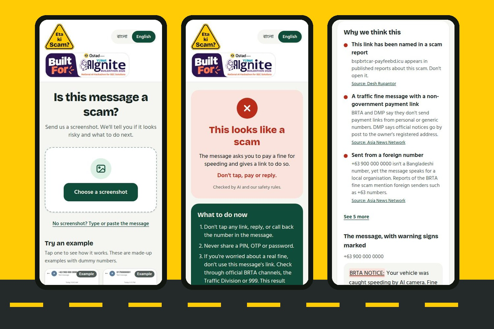

<p align="center">
  
</p>

<h1 align="center">Eta Ki Scam? (এটা কি স্ক্যাম?)</h1>

<p align="center">
  Send a screenshot of a suspicious message. See what looks wrong and what to do next, in Bangla or English.
</p>

<p align="center">
  <a href="https://eta-ki-scam.vercel.app"><strong>Try the live app</strong></a>
</p>



## Why I built it

Fake BRTA fine messages have been spreading since AI traffic cameras were introduced in Bangladesh. They name a fine and a deadline, threaten legal action, and link to a copy of the BRTA website. I've seen people get scammed by them, and many end up asking on Facebook whether a message is real.

Eta Ki Scam? gives them an answer right away, with no app to install and no login.

I built it solo for the Ostad Presents YUNet AIgnite Buildathon 2026.

## What it does

- **Reads your screenshot**, or you can type or paste the message
- **Gives a clear result:** "This looks like a scam", "Be careful with this one" or "No warning signs found"
- **Shows the reasons**, with the risky parts of the message marked
- **Tells you what to do next**, including helplines if you've already paid or shared a code
- **Lets you warn your family** without sharing your private message
- **Works in Bangla and English**, and understands Banglish

It never calls a message "safe", because nobody can promise that.

## How it works

1. **Read:** an AI vision model reads the text, link and sender from the screenshot.
2. **Check:** safety rules look for lookalike links, PIN or OTP requests, foreign senders and common local scam patterns. A public registry shows how new a website is, without ever opening the suspicious link.
3. **Understand:** an AI model looks for tactics the rules can miss, using similar labelled examples for reference.
4. **Decide:** both results become one verdict. The AI can raise the risk, but it can't clear a rule finding, and it has to name something harmful before it can flag a message on its own.

If the AI services are unavailable, the app still answers using its rule checks.

## Results so far

I tested the app on 99 unseen messages from a public Bangla SMS dataset:

| Message type | Flagged |
|---|---|
| Scams | 29 of 33 |
| Promotions | 0 of 33 |
| Normal messages | 2 of 33 |

This is a small sample from one dataset, and some of its labels are questionable, so it isn't a measure of real-world accuracy. I made a few more fixes after this test. Testing on real messages, shared with permission, is the next step.

## Built with

- **App:** Next.js, React, TypeScript and Tailwind CSS, deployed on Vercel
- **AI:** Vercel AI SDK, with open models on Groq and Google Gemini as a backup
- **Testing:** Vitest, plus an evaluation script for measuring detection

## Run it locally

You'll need Node 22 or later, pnpm and a [Groq API key](https://console.groq.com/keys).

```bash
git clone https://github.com/namaray/eta-ki-scam.git
cd eta-ki-scam
pnpm install
cp .env.example .env.local
```

Add your key to `.env.local`, then start the app:

```bash
pnpm dev
```

Without a key, the app still runs on rule checks, but screenshots and AI analysis won't work. You can also add a Google AI Studio key as a backup. Google's free tier may use messages to improve its products, and the app's privacy note says so.

To run the tests and the evaluation:

```bash
pnpm test
pnpm eval --rules-only
```

## Privacy

The app doesn't store messages. They're sent to AI services to be checked, so please hide any passwords or codes first.

## Credits

Some of the app's reference examples and the test results above use the [Bengali SMS Smishing Dataset](https://huggingface.co/datasets/shariul-islam/bengali-sms-smishing-dataset), tagged MIT by its publisher. The example screenshots in the app are made up and use dummy numbers.

## Author

Built by **Namare Shakib Angkon**, a final-trimester student at United International University.
